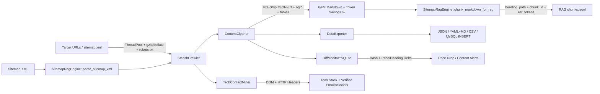

# 🕷️ Nemr Web Intel OS `v3.0.0` (Sovereign Edition)

### *Stealth Gzip/Deflate Crawler, Schema.org & Table Extractor, LLM Markdown & Overlapping RAG Chunker, Sitemap XML Parser, Tech Stack Fingerprinter & SQLite Diff Monitor*

[](https://github.com/ElNeMeR70/nemr-web-intel-os/releases)
[](https://python.org)
[](core/sitemap_rag_engine.py)
[](tests/test_web_intel.py)
[](LICENSE)

---

## 📖 Executive Overview | نظرة عامة معمّقة

**English:**  
Raw HTML destroys LLM context windows with navigation menus, tracking scripts, inline SVGs, and boilerplate wrappers. **Nemr Web Intel OS** is a pure-stdlib web intelligence pipeline that crawls web pages concurrently (with transparent `gzip`/`deflate` decoding and `robots.txt` verification), preserves valuable Schema.org `JSON-LD` and OpenGraph metadata *before* stripping noise, converts HTML headings/lists/links/`<table>` elements into clean GitHub-Flavored Markdown (cutting token consumption dramatically and reporting `token_savings_pct`), chunks Markdown along heading hierarchies with configurable overlap for **RAG vector databases**, parses namespaced XML sitemaps, fingerprints target tech stacks & verified business contacts, and monitors competitor pricing changes in SQLite.

**بالعربية (الشرح الهندسي الكامل):**  
منظومة **`nemr-web-intel-os`** هي محرك استخبارات ويب وإعداد بيانات للذكاء الاصطناعي (**AI / RAG Data Pipeline**) مكتوب بلغة بايثون الخالصة بدون أي مكتبات خارجية. بدلاً من إهدار التوكنز في نصوص الـ HTML العشوائية، الأداة بتسحب الصفحات بذكاء مع فك ضغط `gzip/deflate` وتدعم السحب المتوازي، وتستخلص بيانات **Schema.org JSON-LD** و **OpenGraph** والجداول قبل تجريد السكربتات والإعلانات، وتحوّل المحتوى إلى **Markdown نظيف للـ LLMs** مع قياس نسبة التوفير في التوكنز، ثم تقطّعه تلقائياً إلى **RAG JSONL Chunks** متصلة بالعناوين، وتستخرج خرائط المواقع (`sitemap.xml`) وبصمة التكنولوجيا (`WordPress`, `Next.js`, `Cloudflare`, `Stripe`, `Paymob`) وبيانات التواصل الحقيقية، مع مراقب تغيّر الأسعار عبر SQLite.

---

## 🏗️ System Architecture | معمارية النظام



---

## 🔬 Deep Dive into Core Engines | شرح تفصيلي للمحركات الداخلية

### 1. Sitemap XML Parser & Heading-Aware RAG Chunker ([`core/sitemap_rag_engine.py`](core/sitemap_rag_engine.py))
- **Namespace-Safe XML Parser (`parse_sitemap_xml`)**: Uses `xml.etree.ElementTree` while stripping arbitrary XML namespaces (`{http://www.sitemaps.org/schemas/sitemap/0.9}`) cleanly so both `<urlset>` and nested `<sitemapindex>` files return normalized `loc`, `lastmod`, `priority`, and `changefreq` records.
- **Heading-Aware RAG Chunker (`chunk_markdown_for_rag`)**: Instead of naive fixed-size sliding windows that chop paragraphs mid-heading, this engine tracks `#`, `##`, and `###` hierarchy into a live `heading_path` stack (e.g. `Architecture > Core Engine`), splits oversized sections with bounded `overlap`, estimates LLM tokens (`len(piece) / 4`), and tags each chunk with a deterministic SHA-256 `chunk_id` for idempotent vector database upserts!

### 2. Tech Stack Fingerprinter & Contact Intelligence Miner ([`core/tech_contact_miner.py`](core/tech_contact_miner.py))
Inspects both HTML DOM signatures and HTTP response headers (`Server`, `X-Powered-By`, `CF-Ray`):
- **Tech Stack Detection**: Identifies `WordPress`, `Shopify`, `Next.js`, `React`, `Vue`, `Laravel`, `PHP`, `Cloudflare`, `LiteSpeed`, `Nginx`, `Stripe`, `Paymob`, `Google Tag Manager`, and `Tailwind CSS`.
- **Clean Contact Mining**: Filters out deceptive retina filename strings such as `hero@2x.png` or `logo@3x.webp` so extracted `emails` contain genuine addresses only; captures E.164 phone numbers and normalizes LinkedIn, GitHub, X/Twitter, Facebook, Instagram, YouTube, and WhatsApp links.

### 3. Schema.org JSON-LD, Table & LLM Markdown Distiller ([`core/content_cleaner.py`](core/content_cleaner.py))
Captures structured `<script type="application/ld+json">` Product/Article schemas and `og:*` / `twitter:*` / `canonical` metadata **before** stripping scripts, styles, navbars, and footers. Extracts HTML `<table>` elements into clean Markdown pipe tables, converts links `[text](url)` and headings `#`/`##`/`###`, detects international & regional prices (`$`, `€`, `£`, `EGP`, `SAR`, `AED`, `جنيه`, `ريال`), and computes exact `token_savings_pct`.

### 4. Gzip/Deflate Concurrent Stealth Crawler ([`core/stealth_crawler.py`](core/stealth_crawler.py))
Rotates desktop browser User-Agents, advertises `Accept-Encoding: gzip, deflate`, decompresses `gzip`/`deflate` payloads natively with `gzip` / `zlib`, checks `robots.txt` via `urllib.robotparser`, applies exponential retry backoff, and executes parallel fetches via `ThreadPoolExecutor` (`crawl_batch`).

### 5. SQLite Snapshot Diff Monitor & Polyglot Exporters
- **[`core/diff_monitor.py`](core/diff_monitor.py)**: Computes SHA-256 hashes of normalized content + prices in SQLite and flags exact `added_prices`, `removed_prices`, and `added_headings` across successive crawls.
- **[`core/data_exporter.py`](core/data_exporter.py)**: Exports to JSON, YAML-frontmatter Markdown (`.md`), RFC-compliant CSV (`.csv`), vector-ready `.jsonl`, or MySQL `INSERT INTO` SQL (`.sql`).

---

## 💻 Complete CLI Reference Manual | مرجع الأوامر الكامل

| Command | Arguments & Flags | Purpose |
| :--- | :--- | :--- |
| `parse-sitemap` | `<xml_file_or_url> [--json]` | Parse `<urlset>`/`<sitemapindex>` XML across namespaces |
| `rag-chunks` | `<md_or_html_file> [--max-chars 1000] [--overlap 150] [--source-url URL] [--out chunks.jsonl]` | Distill & chunk into heading-aware RAG JSONL |
| `tech-profile` | `<html_file_or_url> [--json]` | Fingerprint tech stack + extract verified emails/phones/socials |
| `crawl` | `<url> [--timeout 10] [--out file.(md\|json\|jsonl\|csv\|sql\|txt)]` | Crawl live URL & export distilled output |
| `to-markdown` | `<html_file> [--out article.md]` | Convert local HTML to YAML+Markdown & report token savings % |
| `clean` | `<html_file> [--markdown]` | Extract title, headings, prices, or Markdown from HTML |
| `monitor` | `<url_or_html> [--db intel_monitor.db]` | Snapshot content in SQLite & diff price/heading changes |
| `--version` | — | Print exact package version (`3.0.0`) |

### Terminal Walkthrough Examples

```bash
# 1. Extract URLs from a site's XML sitemap
python cli.py parse-sitemap https://elnemer-ai.com/sitemap.xml --json

# 2. Convert a noisy HTML doc into heading-aware RAG JSONL chunks
python cli.py rag-chunks product_docs.html --max-chars 800 --overlap 120 --source-url "https://docs.elnemer-ai.com" --out chunks.jsonl

# 3. Fingerprint target frameworks, payment gateways, CDN & verified contacts
python cli.py tech-profile https://apex.elnemer-ai.com --json

# 4. Distill webpage to LLM Markdown with token savings percentage
python cli.py crawl https://elnemer-ai.com --out distilled.md

# 5. Monitor a product page twice in SQLite to catch competitor price drops
python cli.py monitor product_snapshot.html --db prices.db
```

---

## 🐍 Programmatic Python API Usage

```python
from core import StealthCrawler, ContentCleaner, SitemapRagEngine, TechContactMiner, DiffMonitor

# 1. Fetch & distill webpage cleanly
res = StealthCrawler.fetch_url("https://apex.elnemer-ai.com")
doc = ContentCleaner.clean_html(res.content)
print(f"Saved {doc.token_savings_pct}% characters converting HTML -> Markdown")

# 2. Fingerprint tech stack & filter valid business contacts
intel = TechContactMiner.analyze(res.content, headers=res.headers)
print("Detected stack:", intel["tech_stack"])

# 3. Chunk clean Markdown for vector embeddings
chunks = SitemapRagEngine.chunk_markdown_for_rag(doc.markdown, max_chars=900, overlap=150, source_url=res.url)

# 4. Track price changes in SQLite
mon = DiffMonitor("watch.db")
diff = mon.record_and_diff(res.url, doc)
```

---

## 📦 Installation & AI Agent Integration

```bash
git clone https://github.com/ElNeMeR70/nemr-web-intel-os.git
cd nemr-web-intel-os
pip install -e .
nemr-intel --version
```

Copy [`SKILL.md`](SKILL.md) to `~/.gemini/config/skills/nemr-web-intel-os/SKILL.md` for global Antigravity AI agent availability.

---

## 🧠 RAG Chunking Strategy & Cost Benchmarks | استراتيجية تقطيع البيانات للـ RAG

Raw enterprise docs typically waste **65% to 88%** of vector database tokens on inline `<svg>` paths, `<script>` telemetry tags, sticky header menus, and footer sitemaps. `ContentCleaner` + `SitemapRagEngine` solve this cleanly:

1. **Pre-Strip Metadata Lock**: Parses `<script type="application/ld+json">` structured commerce/article objects and `<meta property="og:*">` tags **before** discarding `<script>` and `<style>`.
2. **Boilerplate Vaporization**: Drops `<nav>`, `<footer>`, `<svg>`, `<noscript>`, and ads while extracting Markdown `<table>` pipes intact.
3. **Heading-Boundary Chunking (`chunk_markdown_for_rag`)**: Maintains a live breadcrumb (`heading_path` e.g. `Architecture > Core Engine`) so every vector chunk retains parent context even when sliced with sliding `overlap`.
4. **Deterministic Chunk Identity**: Each chunk emits a reproducible 16-char SHA-256 `chunk_id` alongside `est_tokens` (`len / 4`), preventing duplicate embeddings on incremental re-crawls.

### Tech Fingerprinting & Contact Sanitization Rules (`TechContactMiner`)
Naive email scrapers match CSS/HTML retina image filenames like `hero@2x.png` or `logo@3x.webp`. `TechContactMiner` explicitly drops image/asset extensions (`.png`, `.jpg`, `.jpeg`, `.gif`, `.webp`, `.svg`, `.woff`, `.css`, `.js`) and requires valid length constraints on phone numbers, returning clean lead & tech-stack intelligence across WordPress, Shopify, Next.js, Laravel, Cloudflare, LiteSpeed, Stripe, and Paymob.

---

## 📊 Comparison Matrix

| Capability | Basic `BeautifulSoup` Script | Cloud SaaS Scrapers ($$$/mo) | **Nemr Web Intel OS v3.0** |
| :--- | :---: | :---: | :---: |
| Zero External Dependencies | ❌ | ❌ | ✅ Pure Stdlib |
| Transparent `gzip`/`deflate` + `robots.txt` | Manual | ✅ | ✅ Built-in |
| Schema.org JSON-LD + GFM Table Preservation | Manual | ✅ | ✅ Native |
| Heading-Aware Overlapping RAG JSONL Chunks | Separate LangChain | Paid Tier | ✅ Native `rag-chunks` |
| SQLite Price & Heading Change Monitor | ❌ | Paid Tier | ✅ Native `monitor` |
| Sitemap XML + Tech Stack Fingerprinter | ❌ | Partial | ✅ Built-in |

### Architectural Guarantees & Edge Cases Handled (معالجة الحالات المعقدة)
1. **Zlib Window Fallback for Broken `deflate` Servers**: Many misconfigured servers send raw `deflate` bitstreams without zlib headers (`Content-Encoding: deflate`). `_decode_body()` tries standard `zlib.decompress(raw)` first and transparently falls back to `-zlib.MAX_WBITS` so compressed pages never turn into binary mojibake.
2. **XML Namespace Normalization**: Most corporate sitemaps declare `xmlns="http://www.sitemaps.org/schemas/sitemap/0.9"`. `SitemapRagEngine._local_tag()` strips XML namespace URIs dynamically, supporting both standard `<urlset>` and nested `<sitemapindex>` without fragile hardcoded prefixes.
3. **SQL Injection-Safe MySQL Exports**: Strings exported via `DataExporter.to_mysql_insert` escape single quotes cleanly (`'` -> `''`) to ensure generated `.sql` seed files import safely across MySQL 8 and MariaDB.
4. **Graceful `robots.txt` Fallback**: Network timeouts fetching `/robots.txt` do not halt legitimate crawl pipelines, while active `Disallow:` directives are respected cleanly.

### Directory Structure | هيكل المشروع

```text
nemr-web-intel-os/
├── core/
│   ├── __init__.py                 # Public v3.0.0 exports
│   ├── stealth_crawler.py          # Gzip/Deflate HTTP client, robots.txt & ThreadPool batching
│   ├── content_cleaner.py          # JSON-LD, OpenGraph, Table parser & LLM Markdown distiller
│   ├── sitemap_rag_engine.py       # Namespaced sitemap.xml parser & heading-aware RAG chunker
│   ├── tech_contact_miner.py       # Tech stack fingerprinter & sanitized email/social extractor
│   ├── data_exporter.py            # JSON, YAML+Markdown, CSV, RAG JSONL & MySQL INSERTs
│   └── diff_monitor.py             # SQLite snapshot price & heading diff detector
├── tests/
│   └── test_web_intel.py           # 12 comprehensive stdlib unit tests
├── cli.py                          # `nemr-intel` CLI entry point (--version 3.0.0)
├── pyproject.toml                  # PEP 621 zero-dependency packaging
├── SKILL.md                        # Antigravity AI agent skill definition
└── LICENSE                         # MIT License
```

### Supported Pipeline Outputs & RAG Embedding Tips (نصائح التجهيز للبحث الدلالي)
- **Vector Store Best Practices**: Use `--max-chars 800 --overlap 120` when feeding developer documentation into Qdrant, pgvector, or Chroma; every emitted JSONL line embeds `heading_path` (`Section > Subsection`) and deterministic 16-char SHA-256 `chunk_id` to enable zero-duplication incremental indexing.
- **Automated Cron Monitoring**: Schedule `nemr-intel monitor https://competitor.example/pricing --db prices.db` hourly on Linux/Hostinger to receive instant JSON diffs whenever competitors adjust pricing or headings.

---

## 🧪 Verification & Tests

```bash
python -m unittest discover -s tests -v
# Ran 12 tests in 0.008s — OK
```

MIT License — Copyright (c) 2026 [Mahmoud ElNeMeR](https://elnemer-ai.com)
